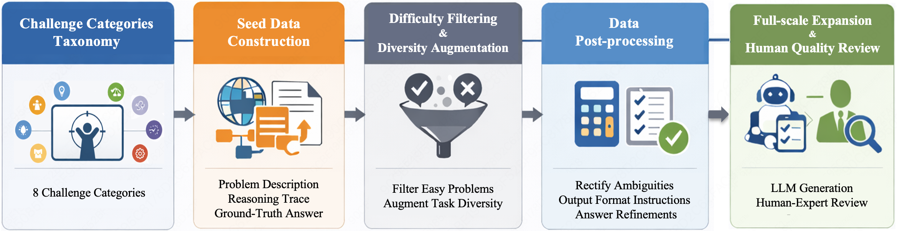
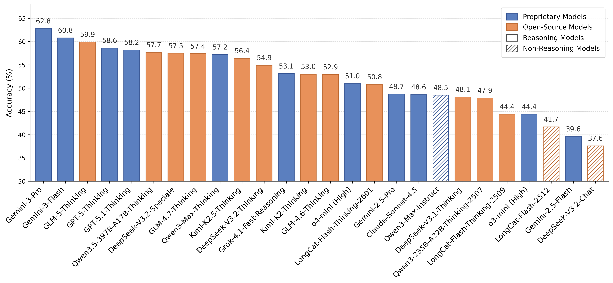
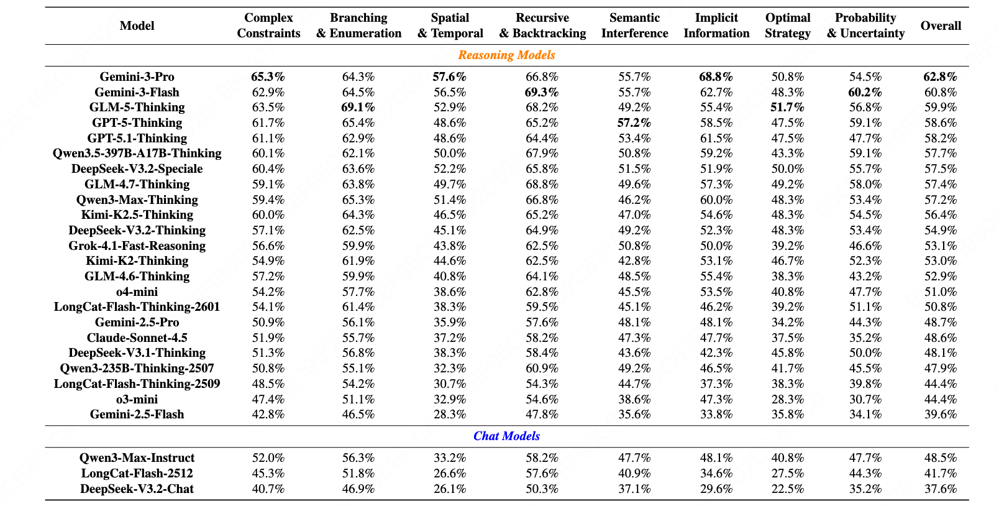

<div align=center><h1>
  🧩 General365: Benchmarking General Reasoning in LLMs Across Diverse and Challenging Tasks
</h1></div>


<p align="center">
  📃 <a href="https://general365.github.io/" target="_blank">Paper</a > • 🌐 <a href="https://general365.github.io/" target="_blank">Project Page</a > • 🏆 <a href="https://general365.github.io/#Leaderboard" target="_blank">Leaderboard</a > • 
  🤗 <a href="https://huggingface.co/datasets/meituan-longcat/General365_Public"_blank">Dataset</a >
  <br>
</p >


## 📖 Introduction

We present **General365**, a highly challenging and diverse benchmark for evaluating the general reasoning capabilities in LLMs.

"General Reasoning" refers to reasoning tasks that depend exclusively on general knowledge.
We define general knowledge as knowledge within the K-12 scope (such as common sense, fundamental linguistics, and basic subject matter), excluding university-level academic knowledge.
Compared to domain-specific reasoning (e.g., Math Reasoning), general reasoning evaluation better decouples a model’s reasoning capability from its knowledge dependence.
This enables a more precise assessment of reasoning skills rather than rote memorization, while testing the generalization of a model's reasoning abilities across broader scenarios.
Current benchmarks for general reasoning face several challenges: a lack of difficulty, insufficient diversity, or overly synthetic characteristics.

Consequently, we introduce **General365**, a manually curated benchmark characterized by high challenge and high diversity, aiming to facilitate more effective evaluation of reasoning capabilities in frontier models.
To ensure the impartiality of the evaluation, we have released only half of the total questions. The remaining questions are maintained as a held-out test set to track potential data contamination within the open-source part.
If you would like to add your model to the leaderboard on the full evaluation set, please feel free to contact us via [Email](anshengnan@meituan.com) or [WeChat](./figures/wechat.png).


## 🌟 Key Features
<p align="center">
    
</p>

- **High Diversity:** It contains 365 manually crafted, highly diverse seed problems, specifically designed to cover a wide range of reasoning challenges and avoid repetitive features or patterns. By altering surface semantics or constraints while preserving core reasoning skills, these seed problems were further expanded into 1,095 variants.
- **Challenging Boundaries:** General365 covers 8 challenging categories, as detailed in Section 2.1 of paper. Even state-of-
the-art models barely achieve a "passing" level of performance on these challenging tasks.
- **Focus on Reasoning over Knowledge:** The knowledge required is strictly confined to the K-12 scope, ensuring the
dataset measures a model’s reasoning capabilities rather than knowledge retrieval.
- **Rigorous Quality Control:** All instances have undergone manual review to ensure the highest standards of quality.
- **Accurate Scoring:** We implemented a hybrid scoring algorithm combining rule-based and model-based approaches,
achieving a manually verified scoring accuracy of 99.59%.


## 🏆 Leaderboard

<p align="center">
    
</p>

## 📊 Main Results
<p align="center">
    
</p>


## 🛠️ Quick Start

### Installation

Clone the repository:
```bash
git clone https://github.com/meituan-longcat/General365.git
cd General365
```

Install dependencies:
```bash
pip install -r requirements.txt
```

### Running evaluations

#### Step 1: Prepaer the Model Response File

After obtaining model responses, format them as follows (one JSON object per line):
```data
{"question_id": 1, "model_response": "..."}
{"question_id": 2, "model_response": "..."}
...
```
Save this file in the `./model_responses/` directory.

#### Step 2: Grading Responses
Set your API key and URL in lines 10-11 of `grading.py`.
Then run:
```bash
python grading.py --response_file example_responses.jsonl
```
Evaluation results will be saved under the  `./grading_results/` directory.

## 🔎 Citation
If you find our work helpful or relevant to your research, please kindly cite our paper:
```
    General365 Paper
```

## 🤗 Acknowledgement

The evaluation script utilizes [Math-Verify](https://github.com/huggingface/Math-Verify) to parse and verify model outputs.
We greatly appreciate the contributors' efforts in providing this valuable tool.


## 📜 License

This project is licensed under the MIT License - see the [LICENSE](./LICENSE) file for details.


## 📪 Support

For questions and support, please open an issue on GitHub or contact the maintainers.
